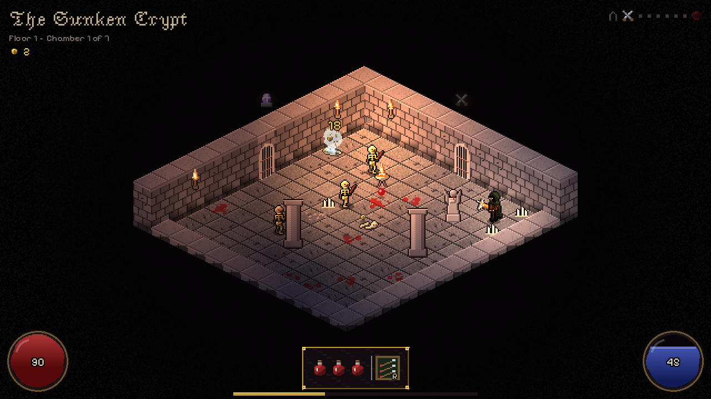
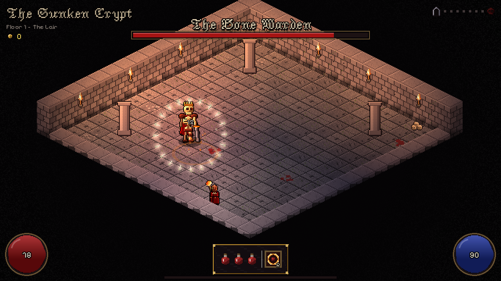
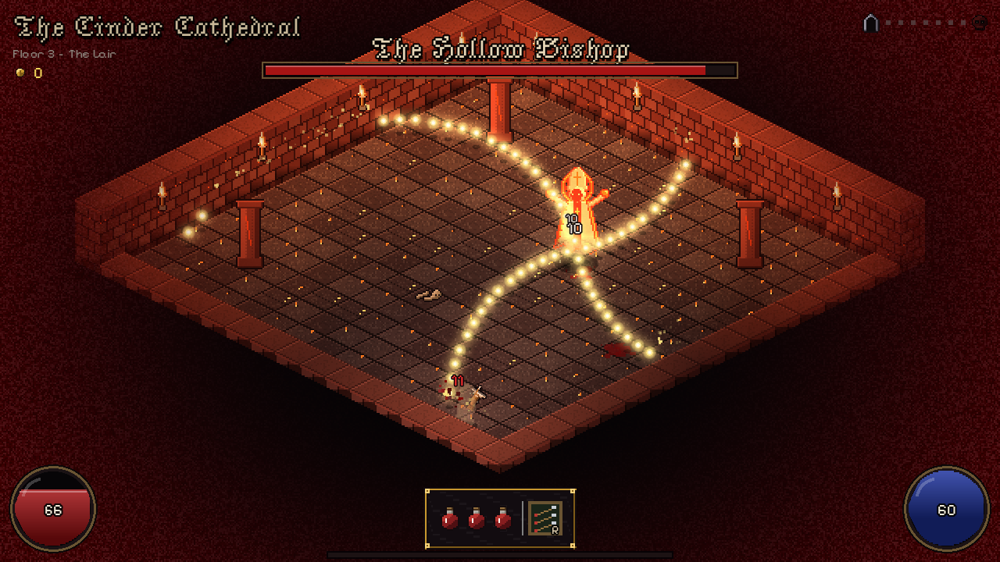
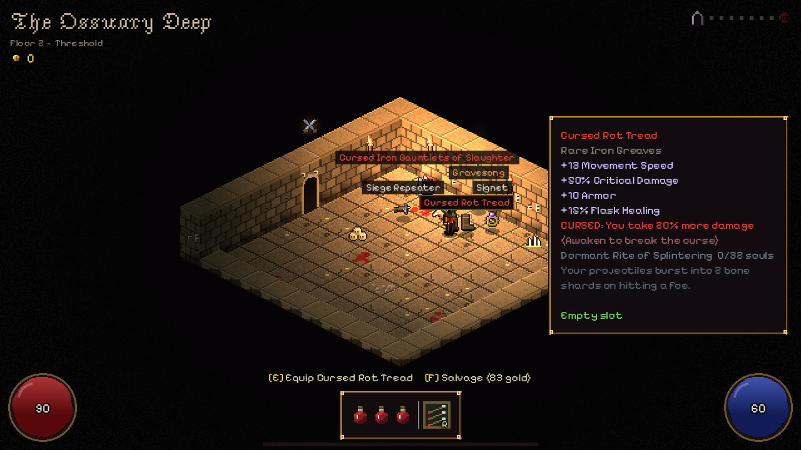
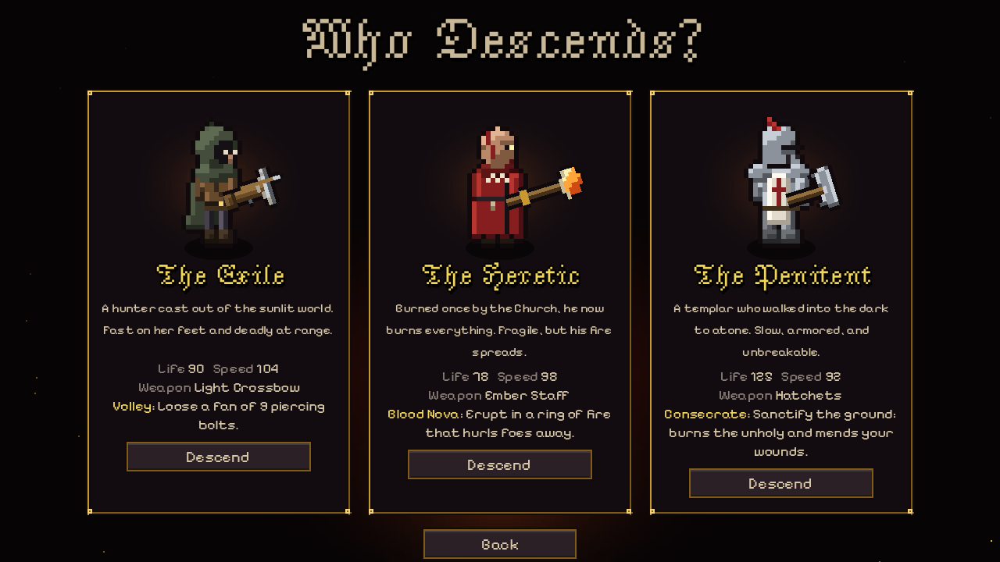

# Grim Gauntlet

A grimdark, isometric, room-by-room roguelite prototype built with **Godot 4.7** (GDScript).
Tiny Rogues-style runs and build-crafting, with a Diablo II / Halls of Torment mood: torch-lit
crypts, liquid life and mana orbs, coloured loot labels and light pillars, named champion monsters.

## Playing on Windows

No install needed. `build/windows/GrimGauntlet.exe` is a single self-contained file (the game data
is embedded). Copy it anywhere on Windows and double-click it. From WSL it lives at
`\\wsl.localhost\Ubuntu\home\sandkar\grim-gauntlet\build\windows\GrimGauntlet.exe`.

The exe is unsigned, so Windows SmartScreen may say "Windows protected your PC". Click
**More info -> Run anyway**.

## Building (Linux only)

```
./build.sh                    # -> build/windows/GrimGauntlet.exe
./build.sh /mnt/c/Games       # build and copy the exe to C:\Games
```

Requirements, which are already set up on this machine:
- The Godot 4.7.2 Linux binary at `~/.local/godot/Godot_v4.7.2-stable_linux.x86_64`
  (or set `GODOT=/path/to/godot`).
- The Windows export templates in `~/.local/share/godot/export_templates/4.7.2.stable/`
  (`windows_release_x86_64.exe`, `windows_debug_x86_64.exe`, `version.txt`, taken from the official
  `Godot_v4.7.2-stable_export_templates.tpz`).

To run it directly on Linux while developing: `~/.local/godot/Godot_v4.7.2-stable_linux.x86_64 --path .`
(WSL has no audio, so the Windows exe is where you'll hear it).

## Controls

| Key | Action |
| --- | --- |
| WASD | Move |
| Mouse | Aim |
| Left click (hold) | Attack |
| Right click / R | Class skill (costs mana) |
| Space / Shift | Dodge roll (invulnerable while rolling) |
| Q | Drink a blood flask |
| E | Equip item / use object |
| F | Salvage the item at your feet for gold |
| Tab / C / I | Character sheet |
| Esc / P | Pause (volume sliders, abandon run) |

## The game

- **3 floors**: The Sunken Crypt, The Ossuary Deep and The Cinder Cathedral. Each floor has 7 chambers
  and then a boss: the Bone Warden, the Mother of Rot and the Hollow Bishop.
- **You pick your path**: a sigil above each gate shows what lies beyond. The options are combat,
  elite (champion packs), reliquary (treasure), the Bone Merchant's shop, an Altar of Awakening,
  or a campfire.
- **3 classes**: the Exile (crossbow, Volley), the Heretic (fire staff, Blood Nova) and the Penitent
  (throwing axes, Consecrate).
- **Level-ups** offer a choice of 1 of 3 Blessings. Pending level-ups are offered after the fight
  instead of interrupting it.
- **Champions** are named elites ("Gorefang the Hungry") with an affix: Fanatic, Stoneskin,
  Fire-Touched or Hexed.

### The twist: Soulbound gear

Loot is deliberately simple: 7 slots, no inventory, and pressing E swaps the item into your slot.
On top of that:

- Every magic, rare or unique item carries a **dormant Rite**, such as Splintering, Chain Lightning,
  Revenant or Corpse Burst (16 in total).
- Every kill feeds souls to all the items you are wearing. When an item has absorbed enough, it
  **awakens** and its Rite activates.
- **Cursed** items (red labels) roll about 40% stronger stats but carry a drawback, such as taking
  more damage or bleeding. Awakening an item breaks its curse for good.
- Swapping an item out resets its souls. Keeping a nearly-awakened item versus taking a shiny new
  drop is the main loot decision.
- The **Altar of Awakening** lets you pay a quarter of your maximum Life to awaken an item instantly.

## Project layout

```
project.godot            engine settings (640x360 pixel viewport, scaled up)
scenes/main.tscn         entry scene (just runs scripts/main.gd)
scripts/
  main.gd                screen flow: title -> class select -> run -> end screen
  run.gd                 one descent: rooms, waves, loot, rites, modals, camera
  autoload/game.gd       global run state, classes, stats, blessings   <- tweak here
  autoload/audio.gd      sound effects + music cross-fading
  data/item_db.gd        weapons, affixes, curses, RITES, uniques      <- tweak here
  data/enemy_db.gd       enemies, floor pools, bosses, champions       <- tweak here
  world/room.gd          isometric room builder (walls, doors, torches, props)
  world/iso.gd           isometric maths
  entities/player.gd     movement, shooting, skills, dodge, flasks
  entities/enemy.gd      monster AI (each attack is telegraphed)
  entities/boss.gd       boss attack patterns and phase 2
  entities/world_objects.gd   ground loot, gold, chest, altar, campfire, shop, portal
  combat/bullets.gd      every projectile, plus on-hit rite effects
  fx/fx.gd, fx/ground_fx.gd   particles, damage numbers, telegraphs, zones
  ui/                    HUD, menus, theme
shaders/                 hit-flash and vignette/grain overlay
tools/gen_art.gd         draws ALL sprites procedurally
tools/gen_sfx.gd         synthesizes ALL sound effects and music
assets/                  generated output + two OFL fonts
```

Most balancing lives in the three "tweak here" files. Numbers there are plain dictionaries.

## Regenerating art and sound

All sprites and audio are generated by code, so you own them outright. Edit the generator and re-run it:

```
godot --headless --path . --script res://tools/gen_art.gd
godot --headless --path . --script res://tools/gen_sfx.gd
```

To replace art with hand-drawn sprites later, keep the same file names and frame layout
(character sheets are 7 frames: idle x2, walk x4, attack).

## Debug options

Pass these after `--` on the command line (or under *Project Settings > Run > Main Run Args*):

- `--autoplay`: a simple bot plays the game. Useful for smoke tests.
- `--class=heretic --floor=2 --first-room=boss`: jump straight in.
- `--open=levelup|sheet|shrine|loot|pause|die`: open a menu or spawn test loot.
- `--timescale=4`, `--quit-after=60`, `--screenshots=2,5 --shotdir=/some/dir`

## Credits

- Fonts: *Jacquarda Bastarda 9* (The Soft Type Project) and *Pixelify Sans* (Pixelify Sans Project
  Authors), both under the SIL Open Font License. The licenses are in `assets/fonts/`.
- Everything else (sprites, tiles, sounds, music) is generated by the scripts in `tools/`.

## Screenshots






